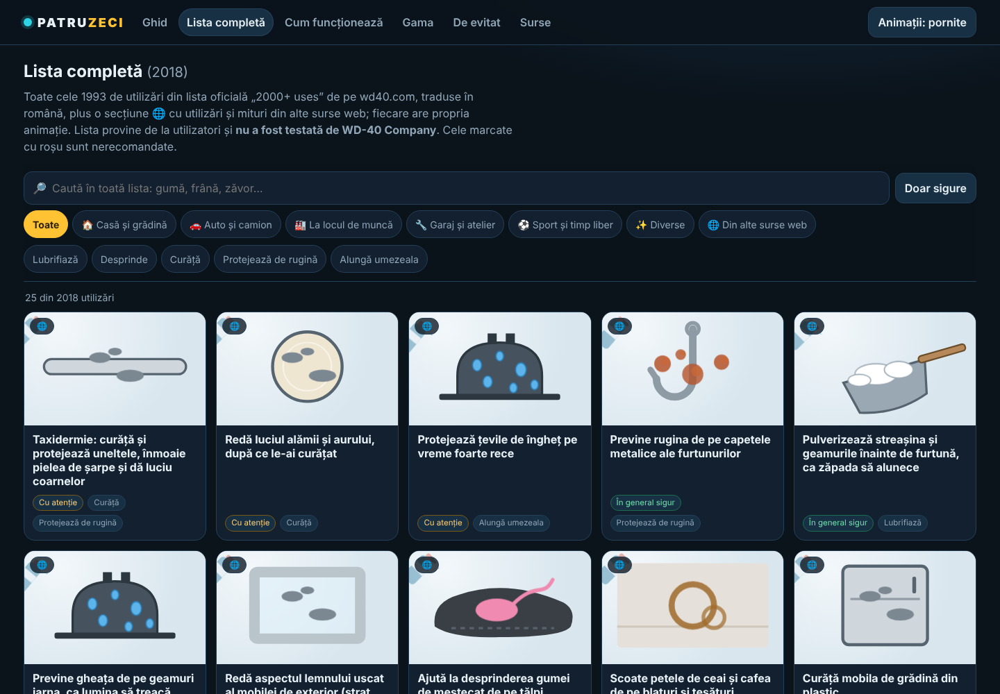
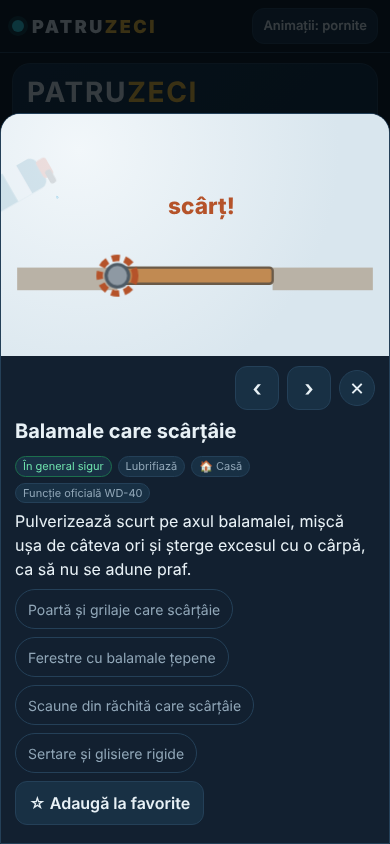
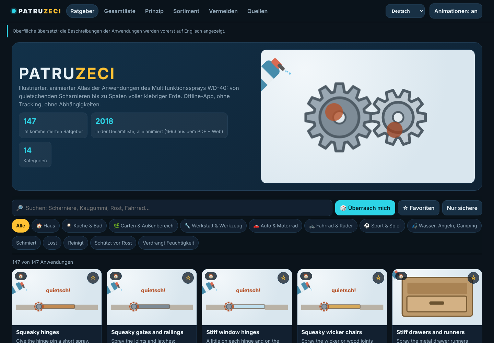
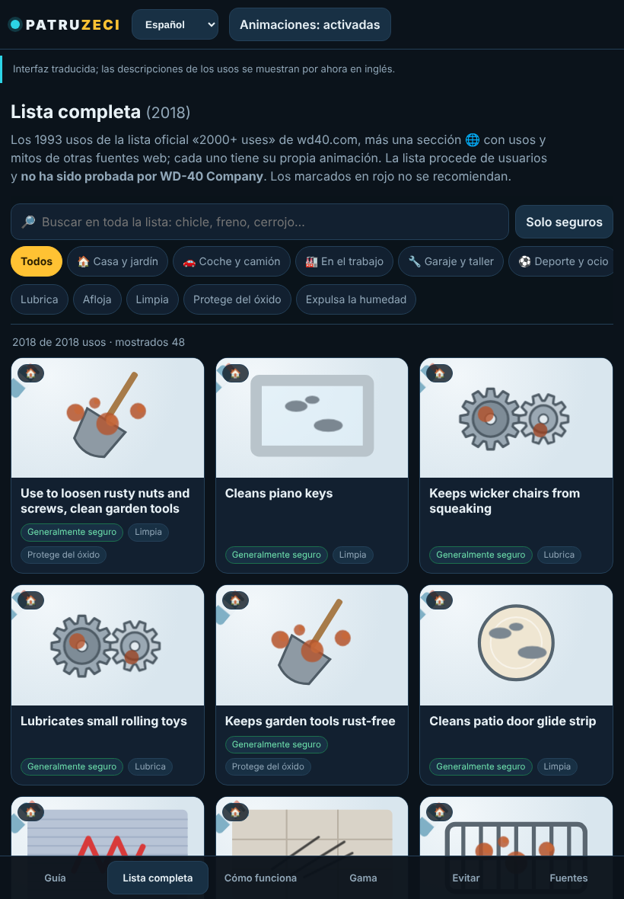
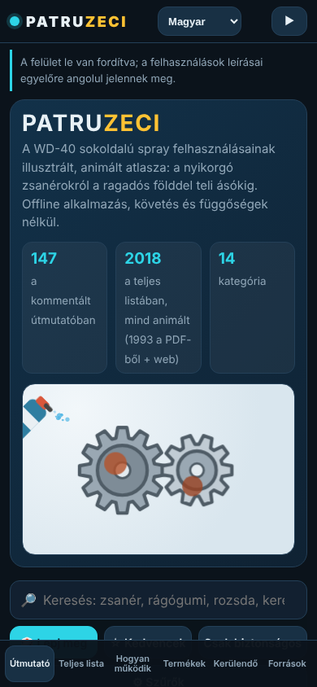

# PATRUZECI

[English](README.md) · [Română](README.ro.md) · [Français](README.fr.md) · [Italiano](README.it.md) · [Español](README.es.md) · [Português](README.pt.md) · **Deutsch** · [Magyar](README.hu.md)

**Version:** 3.8.3 · **Zuletzt aktualisiert:** 2026-11-20

**Status:** stabil · **Offline:** vollständig (läuft von `file://`, ohne Netzwerk)

**Online-App:** [https://chiuta.github.io/PatruZeci/](https://chiuta.github.io/PatruZeci/)

**Der illustrierte, animierte Atlas der WD-40-Anwendungen**

Kurzkarte: Alle 1993 Anwendungen der offiziellen Liste „2000+ uses“, dazu weitere aus dem Web, jede mit eigener animierter Illustration. Einzelne Datei, offline, ohne Konto, ohne Tracking.

Oberflächensprache: **alle 8** — English, Română, Français, Italiano, Español, Português, Deutsch, Magyar (automatisch erkannt, im Kopfbereich umschaltbar). Die Texte der Anwendungen (2018 Einträge) gibt es in allen 8 Sprachen.

## Ausführliche Beschreibung

PATRUZECI ist eine Web-App in einer einzigen Datei, offline (`index.html`, kein Server, kein Konto, kein Tracking), über alles, wofür das Multifunktionsspray WD-40 verwendet wird: von quietschenden Scharnieren bis zu Schaufeln mit klebriger Erde. Sie verbindet einen handgeschriebenen Ratgeber mit der vollständigen offiziellen Liste von Nutzer-Anwendungen, übersetzt und animiert. Der Name bedeutet auf Rumänisch „vierzig“, nach der 40. Formel (WD = Water Displacement, Wasserverdrängung).

## Screenshots

| | | |
|---|---|---|
| <br><sub>Ratgeber: 147 animierte Karten, Filter nach Kategorie und Funktion</sub> | <br><sub>Vollständige Liste: 2018 Anwendungen, sechs offizielle Abschnitte plus ein Web-Abschnitt</sub> | <br><sub>Detailkarte mit Illustration, Risikostufe und Funktions-Tags</sub> |
| <br><sub>Abschnitt 🌐: zusätzliche Anwendungen, Mythen und Warnungen aus Webartikeln</sub> | <br><sub>Tablet (drei Spalten)</sub> | <br><sub>Smartphone: untere Tab-Leiste, zweispaltiges Raster</sub> |
| <br><sub>Smartphone: vollständige Liste</sub> | <br><sub>Smartphone: Detailkarte als Bottom Sheet, Navigation per Wischen</sub> | <br><sub>„Zu vermeiden“: wo WD-40 nicht die richtige Wahl ist</sub> |
| <br><sub>Oberfläche auf Deutsch</sub> | <br><sub>Oberfläche auf Spanisch (Tablet)</sub> | <br><sub>Oberfläche auf Ungarisch (Smartphone)</sub> |

## Was die App enthält

- **Ratgeber** — 147 handgeschriebene Karten in 14 Kategorien, jeweils mit Tipps, Risikostufe (meist unbedenklich / Vorsicht / nicht empfohlen) und der Wirkung des Sprays (schmiert, löst, reinigt, schützt vor Rost, verdrängt Feuchtigkeit).
- **8 Sprachen** — die gesamte Oberfläche (Tabs, Filter, Kategorien, Sicherheitshinweise, Hilfetexte) in English, Română, Français, Italiano, Español, Português, Deutsch und Magyar, gewählt nach Browsersprache oder über die Auswahl im Kopfbereich.
- **Vollständige Liste** — alle 1993 Anwendungen der offiziellen Liste „2000+ uses“, in allen 8 Sprachen, mit Suche und Filtern nach den sechs offiziellen Abschnitten und nach Funktion, mit endlosem Scrollen. Dazu ein Abschnitt 🌐 mit 25 zusätzlichen Anwendungen, Mythen und Warnungen aus aktuellen Webartikeln.
- **Animationen** — 157 Szenenvarianten (Scharnier, Bolzen, Kette, Fleck, Rost, Reißverschluss, Rad, Rolle …): für die Karten des Ratgebers von Hand gewählt, für die vollständige Liste per Regeln zugeordnet. Sie pausieren außerhalb des Bildschirms und stoppen mit „Animationen: aus“ oder wenn das System weniger Bewegung wünscht.
- **Sicherheit zuerst** — 147 Anwendungen sind als „nicht empfohlen“ markiert (Bremsen, Sicherheitsgurte, Lebensmittelkontakt, Koch- und Heizgeräte, Haut und Tiere, Medizinprodukte, Schallplatten …) und 351 mit „Vorsicht“, jeweils mit Erklärung.
- **Responsiv** — Smartphone (untere Tab-Leiste, Details als Bottom Sheet, Wischen), Tablet, Desktop (zweispaltige Details, Pfeiltasten), mit Rücksicht auf sichere Bildschirmbereiche.
- **Tabs** — Funktionsweise, WD-40-Produktpalette, Zu vermeiden, Quellen.
- **Privat** — Favoriten bleiben im lokalen Speicher des Browsers; nichts wird irgendwohin gesendet.
- **Installierbar und offline** — Manifest, Service Worker und Icons (PWA), strenge Content-Security-Policy (keine Netzwerkanfragen), keine externen Abhängigkeiten.

## Grenzen, ehrlich gesagt

Die Illustrationen sind generische animierte Szenen, die per Regeln zu Handlung und Objekt jeder Anwendung passen, keine 2000 einzigartigen Zeichnungen; die automatische Zuordnung kann ungenau sein. Die offizielle Liste stammt von Nutzern und wurde **nicht von der WD-40 Company getestet**; sie ist zudem sehr repetitiv. Die Risikostufen folgen den Regeln des Tabs „Vermeiden“ und den Herstellerwarnungen und wurden per Regeln und manueller Prüfung vergeben, nicht durch Tests: „In der Regel sicher“ ist keine Garantie, lesen Sie also das Etikett. Die rumänische Übersetzung entstand mit KI-Unterstützung. Die Oberfläche und die Texte aller 2018 Einträge gibt es in allen 8 Sprachen; die Übersetzungen ins Französische, Italienische, Spanische, Portugiesische, Deutsche und Ungarische entstanden mit KI-Unterstützung und wurden nicht von Muttersprachlern geprüft.

## Sicherheit

WD-40 ist ein entzündliches Aerosol: von Flammen, Funken und heißen Flächen fernhalten, an einem gut belüfteten Ort arbeiten, nie in die Nähe von Augen oder Gesicht sprühen, außerhalb der Reichweite von Kindern aufbewahren. Vor der Anwendung auf Kunststoff, Lack oder Stoff an verdeckter Stelle testen und Überschuss abwischen. Immer dem Produktetikett und dem Sicherheitsdatenblatt (SDB) folgen. Diese App ist keine technische oder medizinische Beratung.

## Verwendung

Öffne `index.html` in einem aktuellen Browser (läuft von `file://`) oder veröffentliche sie mit GitHub Pages (Workflow enthalten: **Settings → Pages → Source: GitHub Actions**).

## Entwicklung

`index.html` wird aus `src/` erzeugt (Szenen, Daten, Oberfläche, Stile). Nach Änderungen:

```bash
python3 tools/build.py                                    # src/ → index.html
node <hub>/fff-kit/build.mjs release . --bump none --lax  # kit sync (hub: chiuta.github.io)
node tests/app.test.mjs; node tests/data.test.mjs         # tests (Playwright)
```

## Quellen und Danksagung

- Offizielle Liste „2000+ uses“ (wd40.com) und „Top 26 most unusual uses“ — [wd40.com/useArticle/unusual-uses-wd40](https://www.wd40.com/useArticle/unusual-uses-wd40/).
- Gelesene Artikel: Cheapism, Bob Vila, SlashGear, Wide Open Country, Instructables, Snopes und der WD-40-Leitfaden für E-Bikes. Die vollständige Liste steht im Tab „Surse“ der App.

Inoffizielle, unabhängige App. WD-40 ist eine eingetragene Marke der WD-40 Company; die Illustrationen sind original und geben weder Verpackung noch Logo des Produkts wieder.

## Lizenz

[MIT](LICENSE) © 2026 Alexandru-Ionuț Chiuță (Alexio).

## Unterstützung

Wenn es dir gefällt: [Buy Me a Coffee](https://buymeacoffee.com/echo.of.the.strings).
