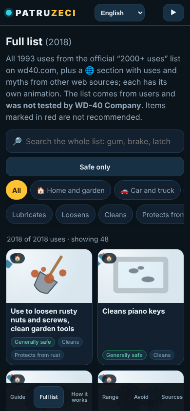
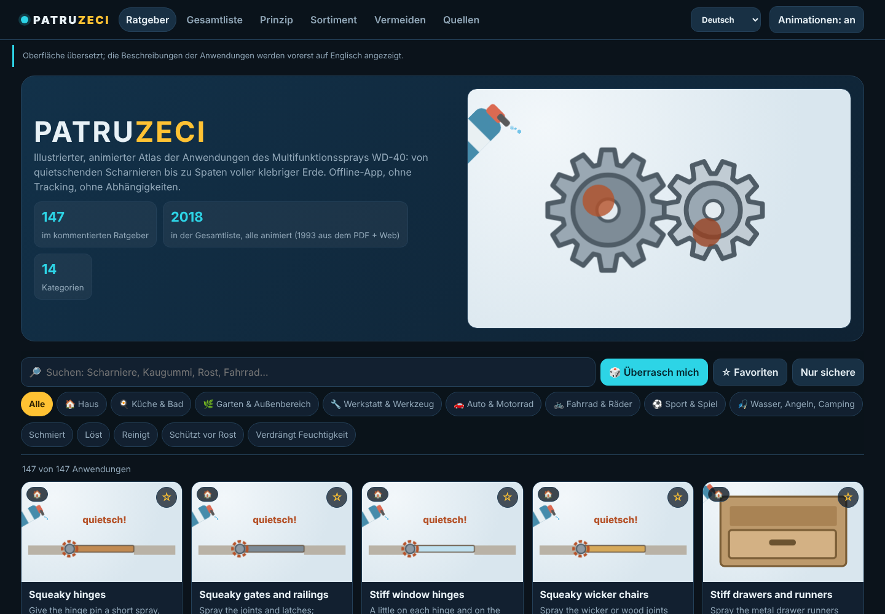
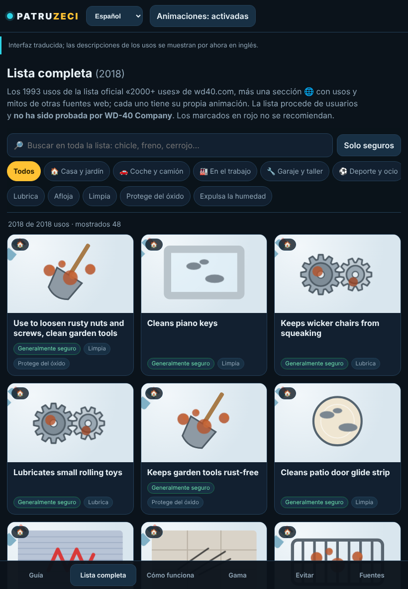
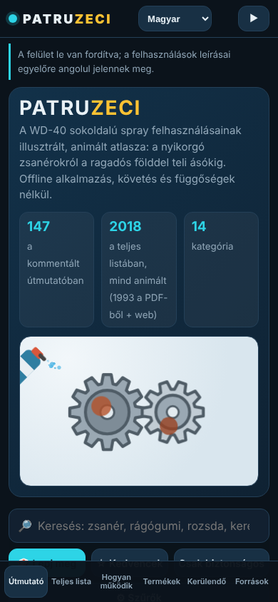

# PATRUZECI

[English](README.md) · [Română](README.ro.md) · [Français](README.fr.md) · [Italiano](README.it.md) · **Español** · [Português](README.pt.md) · [Deutsch](README.de.md) · [Magyar](README.hu.md)

**Versión:** 3.8.1 · **Última actualización:** 2026-11-17

**Estado:** estable · **Sin conexión:** completo (funciona desde `file://`, sin red)

**Aplicación en línea:** [https://chiuta.github.io/PatruZeci/](https://chiuta.github.io/PatruZeci/)

**El atlas ilustrado y animado de los usos del WD-40**

Ficha corta: los 1993 usos de la lista oficial «2000+ uses», más otros de la web, cada uno con su propia ilustración animada. Un solo archivo, sin conexión, sin cuenta, sin rastreo.

Idioma de la interfaz: **los 8** — English, Română, Français, Italiano, Español, Português, Deutsch, Magyar (detectado automáticamente, se cambia en la cabecera). Los textos de los usos (2018 entradas) existen en los 8 idiomas.

## Descripción detallada

PATRUZECI es una aplicación web de un solo archivo, sin conexión (`index.html`, sin servidor, sin cuenta, sin rastreo), sobre todo lo que se puede hacer con el spray multiuso WD-40: desde bisagras que chirrían hasta palas con tierra pegajosa. Combina una guía escrita a mano con la lista oficial completa de usos enviados por los usuarios, traducida y animada. El nombre significa «cuarenta» en rumano, por la fórmula número 40 (WD = Water Displacement, desplazamiento del agua).

## Capturas de pantalla

| | | |
|---|---|---|
| <br><sub>Guía: 147 fichas animadas, filtros por categoría y función</sub> | <br><sub>Lista completa: 2018 usos, seis secciones oficiales y una de la web</sub> | <br><sub>Ficha de detalle con ilustración, nivel de riesgo y etiquetas de función</sub> |
| <br><sub>Sección 🌐: usos adicionales, mitos y advertencias de artículos web</sub> | <br><sub>Tableta (tres columnas)</sub> | <br><sub>Teléfono: barra de pestañas inferior, cuadrícula de dos columnas</sub> |
| <br><sub>Teléfono: lista completa</sub> | <br><sub>Teléfono: ficha de detalle como panel deslizable, navegación con deslizamiento</sub> | <br><sub>«Qué evitar»: dónde WD-40 no es la opción adecuada</sub> |
| <br><sub>Interfaz en alemán</sub> | <br><sub>Interfaz en español (tableta)</sub> | <br><sub>Interfaz en húngaro (teléfono)</sub> |

## Qué contiene la aplicación

- **Guía** — 147 fichas escritas a mano en 14 categorías, cada una con consejos, nivel de riesgo (en general seguro / con precaución / no recomendado) y lo que hace el spray (lubrica, afloja, limpia, protege del óxido, desplaza la humedad).
- **8 idiomas** — toda la interfaz (pestañas, filtros, categorías, notas de seguridad, textos de ayuda) en English, Română, Français, Italiano, Español, Português, Deutsch y Magyar, elegida según el idioma del navegador o el selector de la cabecera.
- **Lista completa** — los 1993 usos de la lista oficial «2000+ uses», traducidos al rumano, con búsqueda y filtros por las seis secciones oficiales y por función, con desplazamiento infinito. Además, una sección 🌐 con 25 usos adicionales, mitos y advertencias de artículos web recientes.
- **Animaciones** — 131 variantes de escena (bisagra, tornillo, cadena, mancha, óxido, cremallera, rueda, polea…) elegidas automáticamente para cada uso. Se pausan fuera de pantalla y se detienen con «Animaciones: apagadas» o cuando el sistema pide menos movimiento.
- **La seguridad primero** — 112 usos están marcados «no recomendado» (frenos, cinturones de seguridad, contacto con alimentos, piel y animales, dispositivos médicos, discos de vinilo…) y 245 «con precaución», cada uno con su explicación.
- **Adaptable** — teléfono (barra de pestañas inferior, detalles en panel deslizable, deslizamiento), tableta, escritorio (detalles en dos columnas, teclas de flecha), respetando las zonas seguras de la pantalla.
- **Pestañas** — Cómo funciona, Gama de productos WD-40, Qué evitar, Fuentes.
- **Privada** — los favoritos se guardan en el almacenamiento local del navegador; nada se envía a ninguna parte.
- **Instalable y sin conexión** — manifiesto, service worker e iconos (PWA), Content-Security-Policy estricta (sin peticiones de red), sin dependencias externas.

## Límites, con franqueza

Las ilustraciones son escenas animadas genéricas asociadas por reglas a la acción y al objeto de cada uso, no 2000 dibujos únicos; la asociación automática puede ser aproximada. La lista oficial procede de los usuarios y **no ha sido probada por WD-40 Company**; además es muy repetitiva. La traducción al rumano se hizo con ayuda de IA. La interfaz está disponible en 8 idiomas, pero los textos de los usos existen en rumano, inglés, francés, italiano y español (los otros tres idiomas los muestran en inglés); las traducciones de la interfaz al francés, italiano, español, portugués, alemán y húngaro se hicieron con ayuda de una IA y no las han revisado hablantes nativos.

## Seguridad

WD-40 es un aerosol inflamable: manténgalo lejos de llamas, chispas y superficies calientes, trabaje en un lugar ventilado, no lo pulverice cerca de los ojos o la cara y manténgalo fuera del alcance de los niños. Pruebe en una zona oculta antes de usarlo sobre plástico, pintura o tela y limpie el exceso. Siga siempre la etiqueta del producto y la ficha de datos de seguridad (FDS). Esta aplicación no es asesoramiento técnico ni médico.

## Uso

Abra `index.html` en cualquier navegador moderno (funciona desde `file://`) o publíquelo con GitHub Pages (incluye un workflow: **Settings → Pages → Source: GitHub Actions**).

## Desarrollo

`index.html` se genera a partir de `src/` (escenas, datos, interfaz, estilos). Tras editar:

```bash
python3 tools/build.py   # src/ → index.html
```

## Fuentes y créditos

- Lista oficial «2000+ uses» (wd40.com) y «Top 26 most unusual uses» — [wd40.com/useArticle/unusual-uses-wd40](https://www.wd40.com/useArticle/unusual-uses-wd40/).
- Artículos consultados: Cheapism, Bob Vila, SlashGear, Wide Open Country, Instructables, Snopes y la guía de WD-40 para bicicletas eléctricas. La lista completa está en la pestaña «Surse» de la aplicación.

Aplicación no oficial e independiente. WD-40 es una marca registrada de WD-40 Company; las ilustraciones son originales y no reproducen el envase ni el logotipo del producto.

## Licencia

[MIT](LICENSE) © 2026 Alexandru-Ionuț Chiuță (Alexio).

## Apoyo

Si te gusta: [Buy Me a Coffee](https://buymeacoffee.com/echo.of.the.strings).
