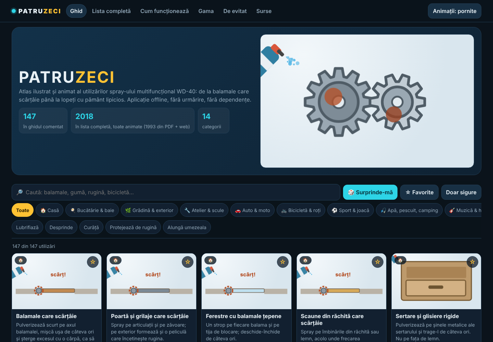

# PATRUZECI

[English](README.md) · [Română](README.ro.md) · **Français** · [Italiano](README.it.md) · [Español](README.es.md) · [Português](README.pt.md) · [Deutsch](README.de.md) · [Magyar](README.hu.md)

**Version:** 3.1.0 · **Dernière mise à jour:** 2026-11-14

**Statut:** stable · **Hors ligne:** complet (fonctionne depuis `file://`, sans réseau)

**Application en ligne:** [https://chiuta.github.io/PatruZeci/](https://chiuta.github.io/PatruZeci/)

**L’atlas illustré et animé des usages du WD-40**

Fiche courte : les 1993 usages de la liste officielle « 2000+ uses », plus d’autres trouvés sur le web, chacun avec sa propre illustration animée. Fichier unique, hors ligne, sans compte, sans pistage.

Langue de l’interface : **Română** pour l’instant (le README existe en 8 langues : English, Română, Français, Italiano, Español, Português, Deutsch, Magyar).

## Description détaillée

PATRUZECI est une application web en un seul fichier, hors ligne (`index.html`, sans serveur, sans compte, sans pistage), sur tout ce que l’on peut faire avec le spray multifonction WD-40 : des charnières qui grincent aux pelles couvertes de terre collante. Elle associe un guide rédigé à la main à la liste officielle complète d’usages proposés par les utilisateurs, traduite et animée. Le nom signifie « quarante » en roumain, d’après la 40e formule (WD = Water Displacement, déplacement de l’eau).

## Captures d’écran

| | | |
|---|---|---|
| <br><sub>Guide : 147 fiches animées, filtres par catégorie et par fonction</sub> | <br><sub>Liste complète : 2018 usages, six sections officielles et une section web</sub> | <br><sub>Fiche détaillée avec illustration, niveau de risque et étiquettes de fonction</sub> |
| <br><sub>Section 🌐 : usages supplémentaires, mythes et avertissements issus d’articles web</sub> | <br><sub>Tablette (trois colonnes)</sub> | <br><sub>Téléphone : barre d’onglets en bas, grille à deux colonnes</sub> |
| <br><sub>Téléphone : liste complète</sub> | <br><sub>Téléphone : fiche détaillée en panneau coulissant, navigation par balayage</sub> | <br><sub>« À éviter » : où WD-40 n’est pas le bon choix</sub> |

## Contenu de l’application

- **Guide** — 147 fiches rédigées à la main en 14 catégories, chacune avec des conseils, un niveau de risque (généralement sûr / prudence / déconseillé) et l’action du spray (lubrifie, débloque, nettoie, protège de la rouille, chasse l’humidité).
- **Liste complète** — les 1993 usages de la liste officielle « 2000+ uses », traduits en roumain, avec recherche et filtres par les six sections officielles et par fonction, et défilement infini. Plus une section 🌐 de 25 usages supplémentaires, mythes et avertissements tirés d’articles web récents.
- **Animations** — 131 variantes de scènes (charnière, boulon, chaîne, tache, rouille, fermeture éclair, roue, poulie…) choisies automatiquement pour chaque usage. Elles se mettent en pause hors écran et s’arrêtent avec « Animations : arrêtées » ou si le système demande moins de mouvement.
- **La sécurité d’abord** — 112 usages sont marqués « déconseillé » (freins, ceintures de sécurité, contact alimentaire, peau et animaux, dispositifs médicaux, disques vinyle…) et 245 « prudence », chacun avec une explication.
- **Adaptatif** — téléphone (barre d’onglets en bas, détails en panneau coulissant, balayage), tablette, ordinateur (détails sur deux colonnes, touches fléchées), zones sûres de l’écran respectées.
- **Onglets** — Fonctionnement, Gamme de produits WD-40, À éviter, Sources.
- **Privé** — les favoris restent dans le stockage local du navigateur ; rien n’est envoyé nulle part.

## Limites, en toute franchise

Les illustrations sont des scènes animées génériques associées par règles à l’action et à l’objet de chaque usage, et non 2000 dessins uniques ; l’association automatique peut être approximative. La liste officielle vient des utilisateurs et **n’a pas été testée par WD-40 Company** ; elle est aussi très répétitive. La traduction roumaine a été réalisée avec l’aide de l’IA. L’interface n’existe pour l’instant qu’en roumain.

## Sécurité

WD-40 est un aérosol inflammable : tenez-le éloigné des flammes, des étincelles et des surfaces chaudes, travaillez dans un lieu aéré, ne pulvérisez jamais près des yeux ou du visage, gardez-le hors de portée des enfants. Testez sur une zone cachée avant de l’utiliser sur du plastique, de la peinture ou du tissu et essuyez l’excédent. Suivez toujours l’étiquette du produit et la fiche de données de sécurité (FDS). Cette application ne constitue pas un conseil technique ou médical.

## Utilisation

Ouvrez `index.html` dans un navigateur récent (il fonctionne depuis `file://`) ou publiez-le avec GitHub Pages (un workflow est fourni : **Settings → Pages → Source : GitHub Actions**).

## Développement

`index.html` est généré à partir de `src/` (scènes, données, interface, styles). Après modification :

```bash
python3 tools/build.py   # src/ → index.html
```

## Sources et crédits

- Liste officielle « 2000+ uses » (wd40.com) et « Top 26 most unusual uses » — [wd40.com/useArticle/unusual-uses-wd40](https://www.wd40.com/useArticle/unusual-uses-wd40/).
- Articles consultés : Cheapism, Bob Vila, SlashGear, Wide Open Country, Instructables, Snopes et le guide WD-40 pour vélos électriques. La liste complète figure dans l’onglet « Surse » de l’application.

Application non officielle et indépendante. WD-40 est une marque déposée de WD-40 Company ; les illustrations sont originales et ne reproduisent ni l’emballage ni le logo du produit.

## Licence

[MIT](LICENSE) © 2026 Alexandru-Ionuț Chiuță (Alexio).

## Soutien

Si l’application vous plaît : [Buy Me a Coffee](https://buymeacoffee.com/echo.of.the.strings).
