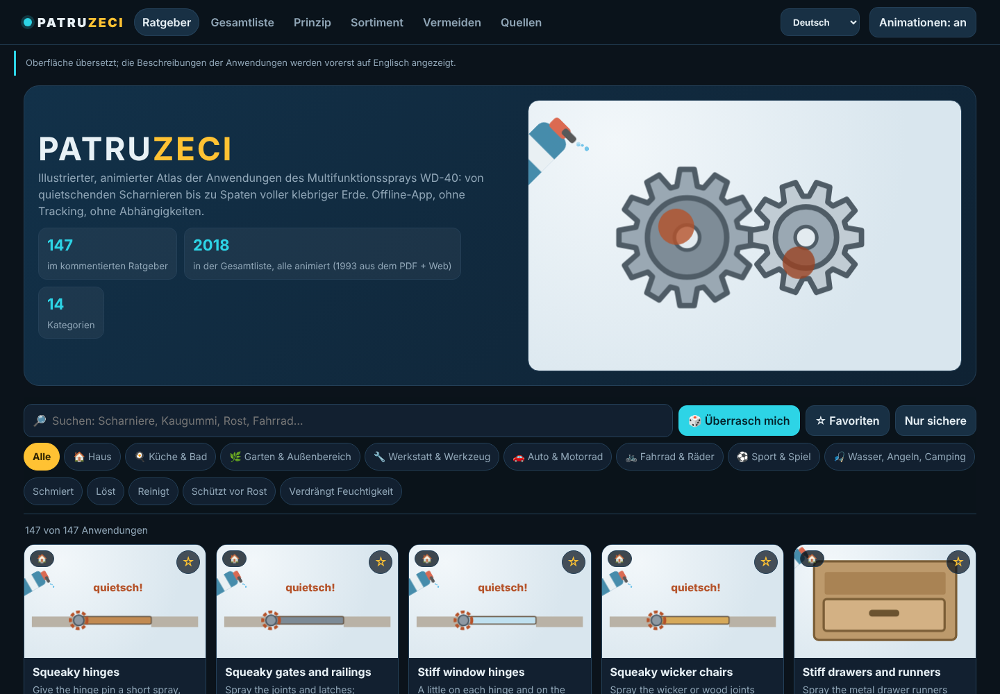
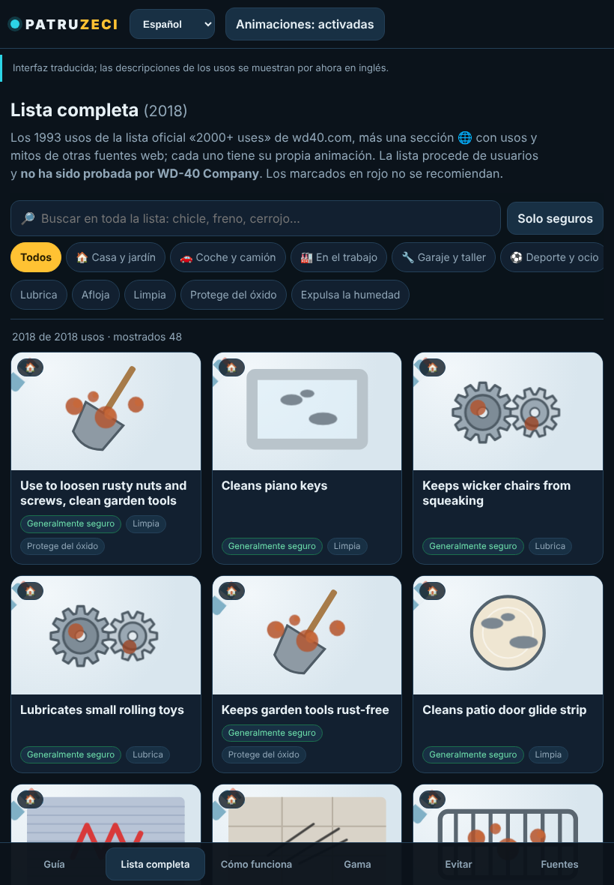
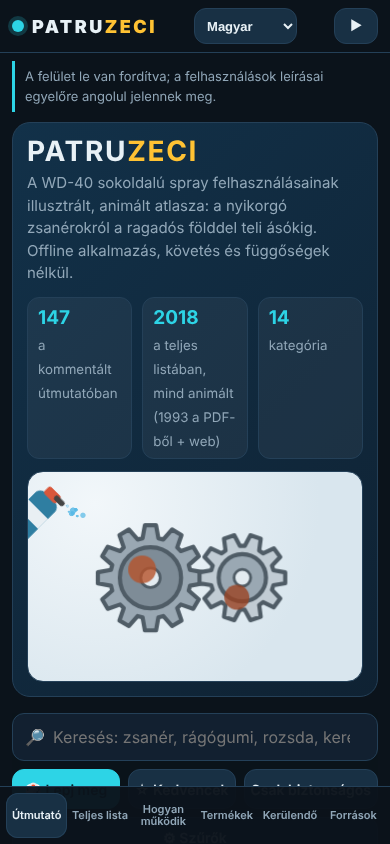

# PATRUZECI

[English](README.md) · [Română](README.ro.md) · [Français](README.fr.md) · [Italiano](README.it.md) · [Español](README.es.md) · [Português](README.pt.md) · [Deutsch](README.de.md) · **Magyar**

**Verzió:** 3.8.1 · **Utolsó frissítés:** 2026-11-17

**Állapot:** stabil · **Offline:** teljes (működik `file://`-ról, hálózat nélkül)

**Online alkalmazás:** [https://chiuta.github.io/PatruZeci/](https://chiuta.github.io/PatruZeci/)

**A WD-40 felhasználási módjainak illusztrált, animált atlasza**

Rövid kártya: a hivatalos „2000+ uses” lista mind az 1993 felhasználási módja, és további webes tippek, mindegyik saját animált illusztrációval. Egyetlen fájl, offline, fiók és követés nélkül.

A felület nyelve: **mind a nyolc** — English, Română, Français, Italiano, Español, Português, Deutsch, Magyar (automatikusan felismerve, a fejlécben váltható). A felhasználások szövegei (2018 bejegyzés) mind a 8 nyelven elérhetők.

## Részletes leírás

A PATRUZECI egyetlen fájlból álló, offline webalkalmazás (`index.html`, szerver, fiók és követés nélkül) arról, mire használható a WD-40 sokoldalú spray: a nyikorgó zsanérokról a ragadós földű lapátig. Kézzel írt útmutatót egyesít a felhasználók által beküldött hivatalos lista teljes anyagával, lefordítva és animálva. A név románul „negyvenet” jelent, a 40. formula után (WD = Water Displacement, vízkiszorítás).

## Képernyőképek

| | | |
|---|---|---|
| <br><sub>Útmutató: 147 animált kártya, szűrők kategória és funkció szerint</sub> | <br><sub>Teljes lista: 2018 felhasználás, hat hivatalos szakasz és egy webes szakasz</sub> | <br><sub>Részletlap illusztrációval, kockázati szinttel és funkciócímkékkel</sub> |
| <br><sub>🌐 szakasz: további felhasználások, mítoszok és figyelmeztetések webes cikkekből</sub> | <br><sub>Táblagép (három oszlop)</sub> | <br><sub>Telefon: alsó fülsáv, kétoszlopos rács</sub> |
| <br><sub>Telefon: teljes lista</sub> | <br><sub>Telefon: részletlap alsó panelként, húzással lapozható</sub> | <br><sub>„Kerülendő”: hol nem a WD-40 a jó választás</sub> |
| <br><sub>Felület németül</sub> | <br><sub>Felület spanyolul (táblagép)</sub> | <br><sub>Felület magyarul (telefon)</sub> |

## Mit tartalmaz az alkalmazás

- **Útmutató** — 147 kézzel írt kártya 14 kategóriában, mindegyik tanáccsal, kockázati szinttel (általában biztonságos / óvatosan / nem ajánlott) és azzal, mit tesz a spray (kenik, kioldja, tisztít, véd a rozsda ellen, kiszorítja a nedvességet).
- **8 nyelv** — a teljes felület (fülek, szűrők, kategóriák, biztonsági megjegyzések, súgószövegek) English, Română, Français, Italiano, Español, Português, Deutsch és Magyar nyelven, a böngésző nyelve vagy a fejléc választója szerint.
- **Teljes lista** — a hivatalos „2000+ uses” lista mind az 1993 felhasználása, románra fordítva, kereséssel és szűréssel a hat hivatalos szakasz és a funkció szerint, végtelen görgetéssel. Plusz egy 🌐 szakasz 25 további felhasználással, mítosszal és figyelmeztetéssel friss webes cikkekből.
- **Animációk** — 131 jelenetváltozat (zsanér, csavar, lánc, folt, rozsda, cipzár, kerék, csiga…), mindegyik felhasználáshoz automatikusan választva. Képernyőn kívül szünetelnek, és az „Animációk: kikapcsolva” beállításra vagy a rendszer csökkentett mozgás kérésére leállnak.
- **Először a biztonság** — 112 felhasználás „nem ajánlott” jelölést kapott (fékek, biztonsági övek, élelmiszerrel érintkezés, bőr és állatok, orvosi eszközök, bakelitlemezek…), 245 pedig „óvatosan”, mindegyik magyarázattal.
- **Reszponzív** — telefon (alsó fülsáv, alsó panel, húzás), táblagép, asztali gép (kétoszlopos részletek, nyílbillentyűk), a képernyő biztonságos területeit tiszteletben tartva.
- **Fülek** — Hogyan működik, A WD-40 termékcsalád, Kerülendő, Források.
- **Privát** — a kedvencek a böngésző helyi tárolójában maradnak; semmi nem kerül sehová elküldésre.
- **Telepíthető és offline** — manifest, service worker és ikonok (PWA), szigorú Content-Security-Policy (nincsenek hálózati kérések), külső függőségek nélkül.

## Korlátok, őszintén

Az illusztrációk általános animált jelenetek, amelyeket szabályok rendelnek az egyes felhasználások műveletéhez és tárgyához; nem 2000 egyedi rajz, és az automatikus párosítás lehet pontatlan. A hivatalos lista felhasználóktól származik, és **a WD-40 Company nem tesztelte**; ráadásul sok az ismétlés. A román fordítás MI segítségével készült. A felület 8 nyelven érhető el, de a felhasználások szövegei csak románul és angolul léteznek (a többi hat nyelv angolul mutatja őket); a felület francia, olasz, spanyol, portugál, német és magyar fordítása MI segítségével készült, és anyanyelvi beszélők nem ellenőrizték.

## Biztonság

A WD-40 gyúlékony aeroszol: tartsd távol lángtól, szikrától és forró felületektől, jól szellőző helyen dolgozz, ne fújd szem vagy arc közelébe, gyerekektől elzárva tárold. Műanyagon, festéken vagy szöveten használat előtt próbáld ki rejtett helyen, és töröld le a felesleget. Mindig kövesd a termék címkéjét és a biztonsági adatlapot (SDS). Az alkalmazás nem műszaki vagy orvosi tanács.

## Használat

Nyisd meg az `index.html` fájlt bármely modern böngészőben (működik `file://`-ról), vagy tedd közzé GitHub Pages-szel (a workflow mellékelve: **Settings → Pages → Source: GitHub Actions**).

## Fejlesztés

Az `index.html` a `src/` mappából generálódik (jelenetek, adatok, felület, stílusok). Szerkesztés után:

```bash
python3 tools/build.py   # src/ → index.html
```

## Források és köszönet

- A hivatalos „2000+ uses” lista (wd40.com) és a „Top 26 most unusual uses” — [wd40.com/useArticle/unusual-uses-wd40](https://www.wd40.com/useArticle/unusual-uses-wd40/).
- Átnézett cikkek: Cheapism, Bob Vila, SlashGear, Wide Open Country, Instructables, Snopes és a WD-40 e-bike szervizútmutatója. A teljes lista az alkalmazás „Surse” fülén található.

Nem hivatalos, független alkalmazás. A WD-40 a WD-40 Company bejegyzett védjegye; az illusztrációk eredetiek, és nem adják vissza a termék csomagolását vagy logóját.

## Licenc

[MIT](LICENSE) © 2026 Alexandru-Ionuț Chiuță (Alexio).

## Támogatás

Ha tetszik: [Buy Me a Coffee](https://buymeacoffee.com/echo.of.the.strings).
