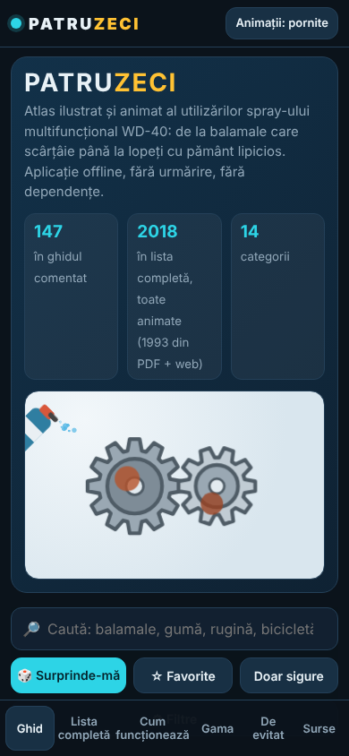
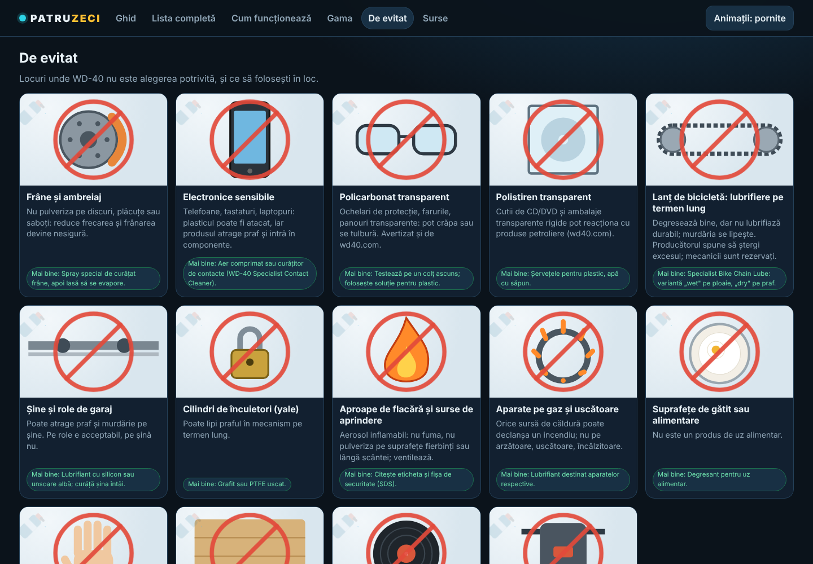

# PATRUZECI

[English](README.md) · [Română](README.ro.md) · [Français](README.fr.md) · **Italiano** · [Español](README.es.md) · [Português](README.pt.md) · [Deutsch](README.de.md) · [Magyar](README.hu.md)

**Versione:** 3.1.0 · **Ultimo aggiornamento:** 2026-11-14

**Stato:** stabile · **Offline:** completo (funziona da `file://`, senza rete)

**App online:** [https://chiuta.github.io/PatruZeci/](https://chiuta.github.io/PatruZeci/)

**L’atlante illustrato e animato degli usi del WD-40**

Scheda breve: tutti i 1993 usi della lista ufficiale «2000+ uses», più altri dal web, ciascuno con la propria illustrazione animata. File unico, offline, senza account, senza tracciamento.

Lingua dell’interfaccia: **Română** per ora (il README esiste in 8 lingue: English, Română, Français, Italiano, Español, Português, Deutsch, Magyar).

## Descrizione dettagliata

PATRUZECI è un’app web in un solo file, offline (`index.html`, senza server, senza account, senza tracciamento), su tutto ciò che si può fare con lo spray multiuso WD-40: dai cardini che cigolano alle pale piene di terra appiccicosa. Unisce una guida scritta a mano alla lista ufficiale completa di usi inviati dagli utenti, tradotta e animata. Il nome significa «quaranta» in rumeno, dalla 40ª formula (WD = Water Displacement, spostamento dell’acqua).

## Schermate

| | | |
|---|---|---|
| <br><sub>Guida: 147 schede animate, filtri per categoria e funzione</sub> | <br><sub>Lista completa: 2018 usi, sei sezioni ufficiali più una dal web</sub> | <br><sub>Scheda di dettaglio con illustrazione, livello di rischio ed etichette di funzione</sub> |
| <br><sub>Sezione 🌐: usi aggiuntivi, miti e avvertenze da articoli web</sub> | <br><sub>Tablet (tre colonne)</sub> | <br><sub>Telefono: barra delle schede in basso, griglia a due colonne</sub> |
| <br><sub>Telefono: lista completa</sub> | <br><sub>Telefono: scheda di dettaglio come pannello scorrevole, navigazione con swipe</sub> | <br><sub>«Da evitare»: dove WD-40 non è la scelta giusta</sub> |

## Cosa contiene l’app

- **Guida** — 147 schede scritte a mano in 14 categorie, ciascuna con consigli, livello di rischio (in genere sicuro / con cautela / sconsigliato) e cosa fa lo spray (lubrifica, sblocca, pulisce, protegge dalla ruggine, scaccia l’umidità).
- **Lista completa** — tutti i 1993 usi della lista ufficiale «2000+ uses», tradotti in rumeno, con ricerca e filtri per le sei sezioni ufficiali e per funzione, con scorrimento infinito. In più una sezione 🌐 con 25 usi aggiuntivi, miti e avvertenze da articoli web recenti.
- **Animazioni** — 131 varianti di scena (cardine, bullone, catena, macchia, ruggine, cerniera lampo, ruota, puleggia…) scelte automaticamente per ogni uso. Si fermano fuori schermo e con «Animazioni: spente» o quando il sistema chiede meno movimento.
- **Prima la sicurezza** — 112 usi sono segnati «sconsigliato» (freni, cinture di sicurezza, contatto con alimenti, pelle e animali, dispositivi medici, dischi in vinile…) e 245 «con cautela», ciascuno con una spiegazione.
- **Adattivo** — telefono (barra delle schede in basso, dettagli a pannello scorrevole, swipe), tablet, desktop (dettagli su due colonne, tasti freccia), rispetto delle aree sicure dello schermo.
- **Schede** — Come funziona, Gamma di prodotti WD-40, Da evitare, Fonti.
- **Privato** — i preferiti restano nella memoria locale del browser; nulla viene inviato altrove.

## Limiti, con franchezza

Le illustrazioni sono scene animate generiche abbinate con regole all’azione e all’oggetto di ciascun uso, non 2000 disegni unici; l’abbinamento automatico può essere approssimativo. La lista ufficiale proviene dagli utenti e **non è stata testata da WD-40 Company**; inoltre è molto ripetitiva. La traduzione in rumeno è stata fatta con l’aiuto dell’IA. L’interfaccia è per ora solo in rumeno.

## Sicurezza

WD-40 è un aerosol infiammabile: tenerlo lontano da fiamme, scintille e superfici calde, lavorare in un luogo ventilato, non spruzzare vicino a occhi o viso, tenere fuori dalla portata dei bambini. Provare su un punto nascosto prima di usarlo su plastica, vernice o tessuti e asciugare l’eccesso. Seguire sempre l’etichetta del prodotto e la scheda di dati di sicurezza (SDS). Questa app non è una consulenza tecnica o medica.

## Uso

Apri `index.html` in un browser moderno (funziona da `file://`) oppure pubblicalo con GitHub Pages (workflow incluso: **Settings → Pages → Source: GitHub Actions**).

## Sviluppo

`index.html` è generato da `src/` (scene, dati, interfaccia, stili). Dopo le modifiche:

```bash
python3 tools/build.py   # src/ → index.html
```

## Fonti e crediti

- Lista ufficiale «2000+ uses» (wd40.com) e «Top 26 most unusual uses» — [wd40.com/useArticle/unusual-uses-wd40](https://www.wd40.com/useArticle/unusual-uses-wd40/).
- Articoli consultati: Cheapism, Bob Vila, SlashGear, Wide Open Country, Instructables, Snopes e la guida WD-40 per e-bike. L’elenco completo è nella scheda «Surse» dell’app.

App non ufficiale e indipendente. WD-40 è un marchio registrato di WD-40 Company; le illustrazioni sono originali e non riproducono la confezione né il logo del prodotto.

## Licenza

[MIT](LICENSE) © 2026 Alexandru-Ionuț Chiuță (Alexio).

## Sostegno

Se ti piace: [Buy Me a Coffee](https://buymeacoffee.com/echo.of.the.strings).
