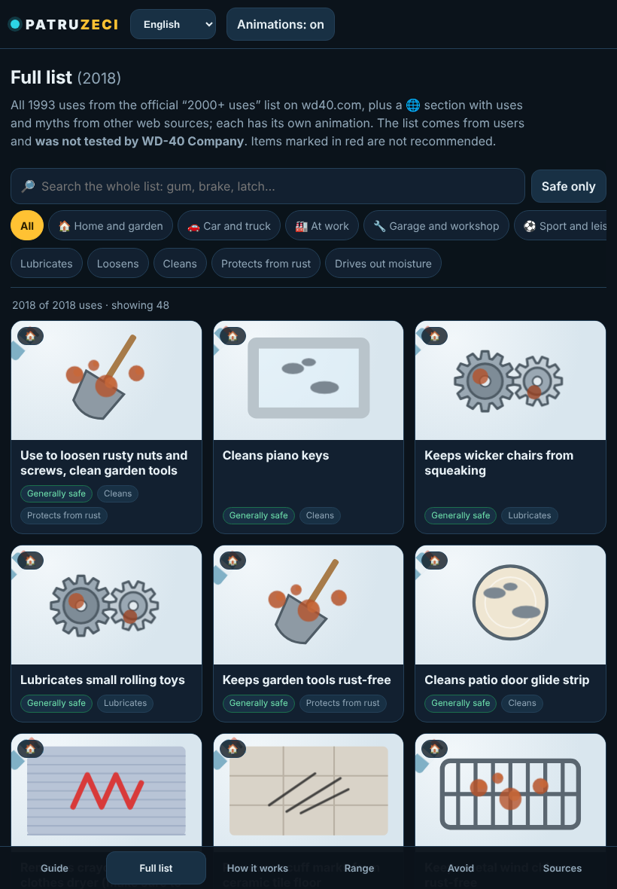
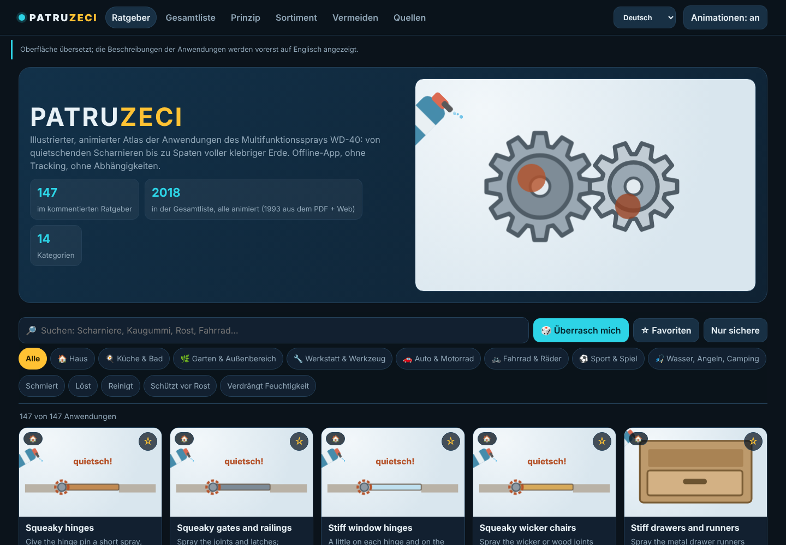
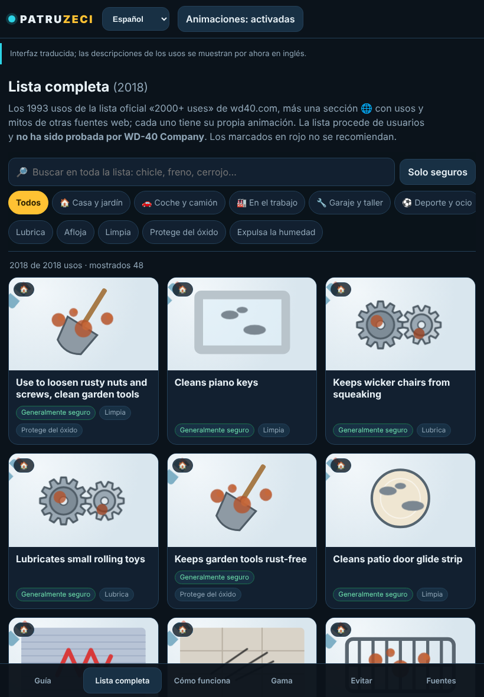
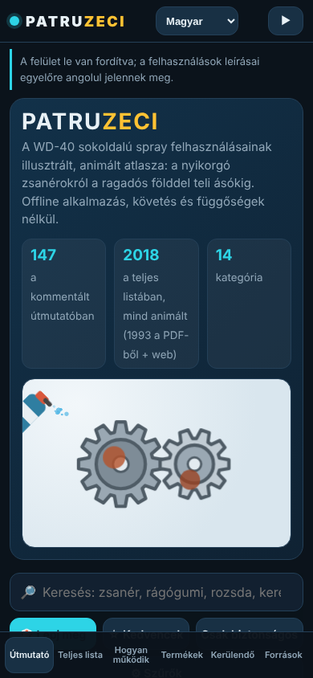

# PATRUZECI

[English](README.md) · [Română](README.ro.md) · [Français](README.fr.md) · [Italiano](README.it.md) · [Español](README.es.md) · **Português** · [Deutsch](README.de.md) · [Magyar](README.hu.md)

**Versão:** 3.2.1 · **Última atualização:** 2026-11-15

**Estado:** estável · **Offline:** completo (funciona a partir de `file://`, sem rede)

**Aplicação online:** [https://chiuta.github.io/PatruZeci/](https://chiuta.github.io/PatruZeci/)

**O atlas ilustrado e animado dos usos do WD-40**

Ficha curta: todos os 1993 usos da lista oficial «2000+ uses», mais outros da web, cada um com a sua própria ilustração animada. Ficheiro único, offline, sem conta, sem rastreamento.

Idioma da interface: **todos os 8** — English, Română, Français, Italiano, Español, Português, Deutsch, Magyar (detetado automaticamente, muda-se no cabeçalho). Os textos dos usos existem em romeno e inglês; os outros seis idiomas mostram-nos por agora em inglês.

## Descrição detalhada

O PATRUZECI é uma aplicação web de um único ficheiro, offline (`index.html`, sem servidor, sem conta, sem rastreamento), sobre tudo o que se pode fazer com o spray multiusos WD-40: desde dobradiças que rangem até pás com terra pegajosa. Junta um guia escrito à mão à lista oficial completa de usos enviados pelos utilizadores, traduzida e animada. O nome significa «quarenta» em romeno, por causa da 40.ª fórmula (WD = Water Displacement, deslocamento da água).

## Capturas de ecrã

| | | |
|---|---|---|
| <br><sub>Guia: 147 fichas animadas, filtros por categoria e função</sub> | <br><sub>Lista completa: 2018 usos, seis secções oficiais e uma da web</sub> | <br><sub>Ficha de detalhe com ilustração, nível de risco e etiquetas de função</sub> |
| <br><sub>Secção 🌐: usos adicionais, mitos e avisos de artigos web</sub> | <br><sub>Tablet (três colunas)</sub> | <br><sub>Telemóvel: barra de separadores em baixo, grelha de duas colunas</sub> |
| <br><sub>Telemóvel: lista completa</sub> | <br><sub>Telemóvel: ficha de detalhe como painel deslizante, navegação por deslize</sub> | <br><sub>«A evitar»: onde o WD-40 não é a escolha certa</sub> |
| <br><sub>Interface em alemão</sub> | <br><sub>Interface em espanhol (tablet)</sub> | <br><sub>Interface em húngaro (telemóvel)</sub> |

## O que contém a aplicação

- **Guia** — 147 fichas escritas à mão em 14 categorias, cada uma com conselhos, nível de risco (em geral seguro / com cuidado / não recomendado) e o que o spray faz (lubrifica, solta, limpa, protege da ferrugem, afasta a humidade).
- **8 idiomas** — toda a interface (separadores, filtros, categorias, notas de segurança, textos de ajuda) em English, Română, Français, Italiano, Español, Português, Deutsch e Magyar, escolhida pelo idioma do navegador ou pelo seletor do cabeçalho.
- **Lista completa** — todos os 1993 usos da lista oficial «2000+ uses», traduzidos para romeno, com pesquisa e filtros pelas seis secções oficiais e por função, com deslocamento infinito. Além disso, uma secção 🌐 com 25 usos adicionais, mitos e avisos de artigos web recentes.
- **Animações** — 131 variantes de cena (dobradiça, parafuso, corrente, mancha, ferrugem, fecho de correr, roda, polia…) escolhidas automaticamente para cada uso. Param fora do ecrã e com «Animações: desligadas» ou quando o sistema pede menos movimento.
- **Segurança primeiro** — 112 usos estão marcados «não recomendado» (travões, cintos de segurança, contacto com alimentos, pele e animais, dispositivos médicos, discos de vinil…) e 245 «com cuidado», cada um com explicação.
- **Adaptável** — telemóvel (barra de separadores em baixo, detalhes em painel deslizante, deslize), tablet, computador (detalhes em duas colunas, teclas de seta), respeitando as áreas seguras do ecrã.
- **Separadores** — Como funciona, Gama de produtos WD-40, A evitar, Fontes.
- **Privada** — os favoritos ficam no armazenamento local do navegador; nada é enviado para lado nenhum.
- **Instalável e offline** — manifesto, service worker e ícones (PWA), Content-Security-Policy rigorosa (sem pedidos de rede), sem dependências externas.

## Limites, com franqueza

As ilustrações são cenas animadas genéricas associadas por regras à ação e ao objeto de cada uso, e não 2000 desenhos únicos; a associação automática pode ser aproximada. A lista oficial vem dos utilizadores e **não foi testada pela WD-40 Company**; é também muito repetitiva. A tradução para romeno foi feita com ajuda de IA. A interface está disponível em 8 idiomas, mas os textos dos usos existem apenas em romeno e inglês (os outros seis idiomas mostram-nos em inglês); as traduções da interface para francês, italiano, espanhol, português, alemão e húngaro foram feitas com ajuda de uma IA e não foram revistas por falantes nativos.

## Segurança

O WD-40 é um aerossol inflamável: mantenha-o longe de chamas, faíscas e superfícies quentes, trabalhe num local ventilado, não pulverize perto dos olhos ou do rosto e mantenha-o fora do alcance das crianças. Teste num local escondido antes de usar em plástico, tinta ou tecido e limpe o excesso. Siga sempre o rótulo do produto e a ficha de dados de segurança (FDS). Esta aplicação não é aconselhamento técnico nem médico.

## Utilização

Abra `index.html` num navegador moderno (funciona a partir de `file://`) ou publique-o com o GitHub Pages (workflow incluído: **Settings → Pages → Source: GitHub Actions**).

## Desenvolvimento

O `index.html` é gerado a partir de `src/` (cenas, dados, interface, estilos). Depois de editar:

```bash
python3 tools/build.py   # src/ → index.html
```

## Fontes e créditos

- Lista oficial «2000+ uses» (wd40.com) e «Top 26 most unusual uses» — [wd40.com/useArticle/unusual-uses-wd40](https://www.wd40.com/useArticle/unusual-uses-wd40/).
- Artigos consultados: Cheapism, Bob Vila, SlashGear, Wide Open Country, Instructables, Snopes e o guia WD-40 para bicicletas elétricas. A lista completa está no separador «Surse» da aplicação.

Aplicação não oficial e independente. WD-40 é uma marca registada da WD-40 Company; as ilustrações são originais e não reproduzem a embalagem nem o logótipo do produto.

## Licença

[MIT](LICENSE) © 2026 Alexandru-Ionuț Chiuță (Alexio).

## Apoio

Se gostar: [Buy Me a Coffee](https://buymeacoffee.com/echo.of.the.strings).
