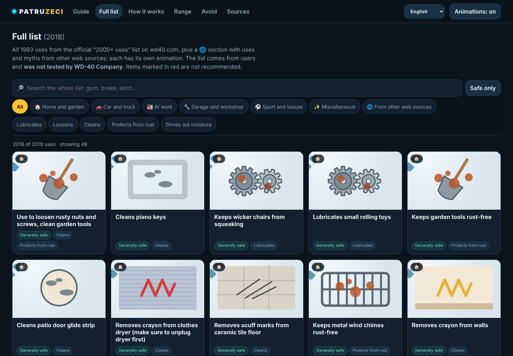
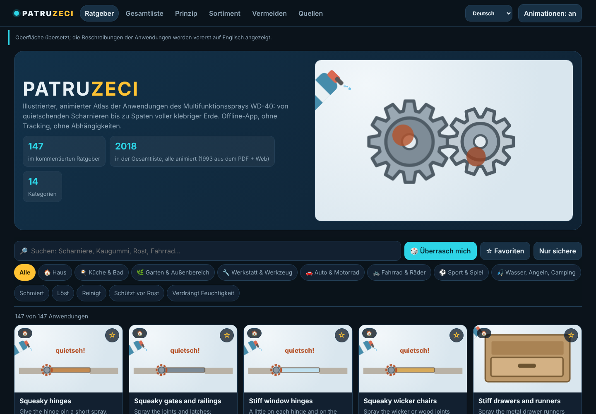
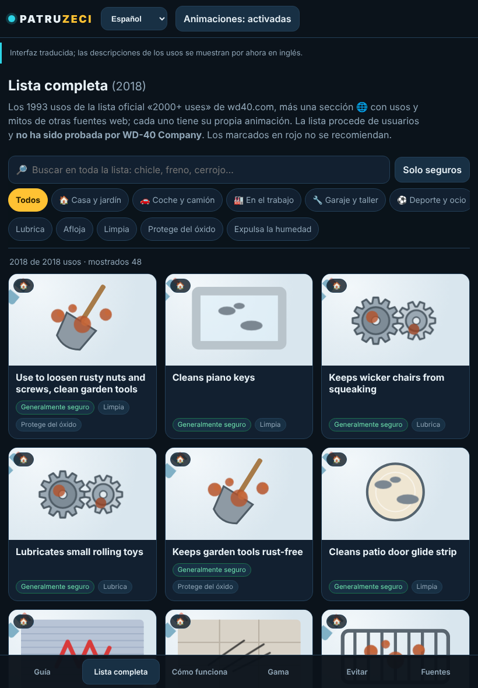
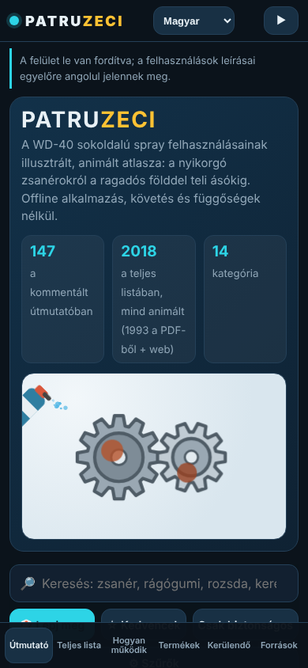

# PATRUZECI

[English](README.md) · **Română** · [Français](README.fr.md) · [Italiano](README.it.md) · [Español](README.es.md) · [Português](README.pt.md) · [Deutsch](README.de.md) · [Magyar](README.hu.md)

**Versiune:** 3.8.1 · **Ultima actualizare:** 2026-11-17

**Stare:** stabil · **Offline:** complet (funcționează din `file://`, nu cere internet)

**Aplicația online:** [https://chiuta.github.io/PatruZeci/](https://chiuta.github.io/PatruZeci/)

**Atlasul ilustrat și animat al utilizărilor WD-40**

Cartea scurtă: toate cele 1993 de utilizări din lista oficială „2000+ uses”, plus altele de pe web, fiecare cu propria ilustrație animată. Fișier unic, offline, fără cont, fără urmărire.

Limba interfeței: **toate cele 8** — English, Română, Français, Italiano, Español, Português, Deutsch, Magyar (detectată automat, se schimbă din antet). Textele utilizărilor (2018 de intrări) sunt disponibile în toate cele 8 limbi.

## Descriere detaliată

PATRUZECI este o aplicație web dintr-un singur fișier, offline (`index.html`, fără server, fără cont, fără urmărire), despre tot ce se poate face cu spray-ul multifuncțional WD-40: de la balamale care scârțâie până la lopeți cu pământ lipicios. Îmbină un ghid scris de mână cu lista oficială completă de utilizări trimise de utilizatori, tradusă și animată. Numele înseamnă „patruzeci”, după a 40-a formulă (WD = Water Displacement, deplasarea apei).

## Capturi de ecran

| | | |
|---|---|---|
| <br><sub>Ghid: 147 de fișe animate, filtre pe categorii și funcții</sub> | <br><sub>Lista completă: 2018 utilizări, șase secțiuni oficiale plus una de pe web</sub> | <br><sub>Fișa de detalii cu ilustrație, nivel de risc și etichete de funcție</sub> |
| <br><sub>Secțiunea 🌐: utilizări suplimentare, mituri și avertismente din articole web</sub> | <br><sub>Tabletă (trei coloane)</sub> | <br><sub>Telefon: bară de file jos, grilă pe două coloane</sub> |
| <br><sub>Telefon: lista completă</sub> | <br><sub>Telefon: fișa de detalii ca panou glisant, cu navigare prin glisare</sub> | <br><sub>„De evitat”: unde WD-40 nu este alegerea potrivită</sub> |
| <br><sub>Interfață în germană</sub> | <br><sub>Interfață în spaniolă (tabletă)</sub> | <br><sub>Interfață în maghiară (telefon)</sub> |

## Ce conține aplicația

- **Ghid** — 147 de fișe scrise de mână, în 14 categorii, fiecare cu sfaturi, nivel de risc (în general sigur / cu atenție / nerecomandat) și ce face spray-ul (lubrifiază, desprinde, curăță, protejează de rugină, alungă umezeala).
- **8 limbi** — toată interfața (file, filtre, categorii, note de siguranță, texte de ajutor) în English, Română, Français, Italiano, Español, Português, Deutsch și Magyar, aleasă după limba browserului sau din selectorul din antet.
- **Lista completă** — toate cele 1993 de utilizări din lista oficială „2000+ uses”, traduse în română, cu căutare și filtre pe cele șase secțiuni oficiale și pe funcție, cu derulare infinită. Plus o secțiune 🌐 cu 25 de utilizări suplimentare, mituri și avertismente din articole web recente.
- **Animații** — 131 de variante de scenă (balama, șurub, lanț, pată, rugină, fermoar, roată, scripete…) alese automat pentru fiecare utilizare. Se opresc când nu sunt pe ecran și cu „Animații: oprite” sau când sistemul cere mișcare redusă.
- **Siguranța înainte de toate** — 112 utilizări sunt marcate „nerecomandat” (frâne, centuri de siguranță, contact cu alimentele, piele și animale, dispozitive medicale, discuri de vinil…) și 245 „cu atenție”, fiecare cu explicație.
- **Adaptabilă** — telefon (bară de file jos, detalii ca panou glisant, glisare), tabletă, desktop (detalii pe două coloane, săgeți de la tastatură), cu respectarea zonelor de siguranță ale ecranului.
- **File** — Cum funcționează, Gama de produse WD-40, De evitat, Surse.
- **Privată** — favoritele rămân în stocarea locală a browserului; nimic nu este trimis nicăieri.
- **Instalabilă și offline** — manifest, service worker și iconițe (PWA), politică strictă Content-Security-Policy (fără cereri în rețea), fără dependențe externe.

## Limite, spuse deschis

Ilustrațiile sunt scene animate generice, potrivite prin reguli cu acțiunea și obiectul fiecărei utilizări, nu 2000 de desene unice; potrivirea automată poate fi aproximativă. Lista oficială provine de la utilizatori și **nu a fost testată de WD-40 Company**; este, de asemenea, foarte repetitivă. Traducerea în română a fost făcută cu ajutorul IA. Interfața există în 8 limbi, dar textele utilizărilor există doar în română și engleză (în celelalte șase limbi se arată în engleză); traducerile interfeței în franceză, italiană, spaniolă, portugheză, germană și maghiară au fost făcute cu ajutor AI și nu au fost verificate de vorbitori nativi.

## Siguranță

WD-40 este un aerosol inflamabil: ține-l departe de flăcări, scântei și suprafețe fierbinți, lucrează într-un loc ventilat, nu pulveriza lângă ochi sau față, ține-l la îndemâna adulților. Testează pe un loc ascuns înainte de a-l folosi pe plastic, vopsea sau textile și șterge excesul. Urmează întotdeauna eticheta produsului și fișa cu date de securitate (SDS). Aplicația nu este recomandare tehnică sau medicală.

## Utilizare

Deschide `index.html` în orice browser modern (funcționează din `file://`) sau publică-l cu GitHub Pages (workflow inclus: **Settings → Pages → Source: GitHub Actions**).

## Dezvoltare

`index.html` este generat din `src/` (scene, date, interfață, stiluri). După modificări:

```bash
python3 tools/build.py   # src/ → index.html
```

## Surse și credite

- Lista oficială „2000+ uses” (wd40.com) și „Top 26 most unusual uses” — [wd40.com/useArticle/unusual-uses-wd40](https://www.wd40.com/useArticle/unusual-uses-wd40/).
- Articole consultate: Cheapism, Bob Vila, SlashGear, Wide Open Country, Instructables, Snopes și ghidul WD-40 pentru bicicletele electrice. Lista completă este în fila „Surse” a aplicației.

Aplicație neoficială, independentă. WD-40 este marcă înregistrată a WD-40 Company; ilustrațiile sunt originale și nu reproduc ambalajul sau sigla produsului.

## Licență

[MIT](LICENSE) © 2026 Alexandru-Ionuț Chiuță (Alexio).

## Susținere

Dacă îți place: [Buy Me a Coffee](https://buymeacoffee.com/echo.of.the.strings).
